<h1 align="center">@averoa/core</h1>

<p align="center">
  <b>The engine of <a href="https://github.com/budiherma1/averoajs">AveroaJS</a>: one call builds a secure Express 5 app.</b><br>
  Security headers, CORS, body parsing, sessions, passport, CSRF, Edge views, routes, 404/error handling, graceful
  shutdown, plus the <code>averoa</code> CLI generators and the knexfile.
</p>

<p align="center">
  <a href="https://www.npmjs.com/package/@averoa/core"></a>
  <a href="#license"></a>
  = 18.17">
  
  
</p>

---

> **Starting a new project?** Use the [AveroaJS boilerplate](https://github.com/budiherma1/averoajs). It already
> has `@averoa/core` wired in. This page is the reference for the package itself.

## ✨ What it gives you

| | |
| --- | --- |
| 🧱 **App in one call**<br>`start()` builds and listens, and `createApp()` builds without listening, for tests. | 🛡️ **Secure by default**<br>helmet 8 CSP, CSRF on web routes, `httpOnly` / `sameSite` session cookies, a strict CORS whitelist. |
| 🧩 **Convention over wiring**<br>Picks up `routes/api.js`, `routes/web.js`, strategies and providers from your app. Each one is optional. | 🛠️ **`averoa` CLI**<br>`make:controller`, `make:model`, `make:crud` and more, with no accidental overwrites. |
| 🗄️ **Ready-made knexfile**<br>Works with `knex migrate:*` from any working directory. | 🛑 **Graceful shutdown**<br>On SIGTERM/SIGINT it closes the server, the DB and the queue, bounded by `SHUTDOWN_TIMEOUT`. |

## 📦 Install

```sh
npm i @averoa/core @averoa/routes @averoa/utilities express edge.js knex objection passport
```

`express` ^5, `passport` ^0.7, `objection` ^3, `knex` ^3, `edge.js` ^5, `@averoa/utilities` ^2 and `@averoa/routes` ^3
are **peer dependencies**. The app installs them, so the app and the framework share one copy.

## 🚀 Usage

```js
// server.js
import { start } from '@averoa/core';
await start(); // → { app, server }

// averoa.js
import { command } from '@averoa/core';
command();
```

```js
// a test: build the app without listening
import { createApp } from '@averoa/core';

const { app } = await createApp();
const server = app.listen(0);
```

## 📚 API

| export | description |
| --- | --- |
| `start(options?)` | `createApp` + listen. `options.port` (default `APP_PORT`, then 3000), `options.host`, `options.handleSignals` (default `true`). Resolves to `{ app, server }`. |
| `createApp(options?)` | Builds the app without listening. Resolves to `{ app }`. Use this in tests. |
| `command(argv?)` | Runs the CLI (`make:controller`, `make:middleware`, `make:model`, `make:crud`, `make:helper`, `make:job`, `make:repository`, `make:strategy`; `--force` to overwrite). |
| `env` | `dotenv`, after loading `<app root>/.env`. |

The app root is `AVEROA_ROOT`, or the nearest `package.json` above the working directory that is
not inside `node_modules`.

### Files core loads from your app

All of them are optional:

| File | Used as |
| --- | --- |
| `routes/api.js` | default export with `async init()` (an `@averoa/routes` router). Mounted at `/api`, **without** CSRF. |
| `routes/web.js` | mounted at `/`, **with** CSRF. |
| `app/Strategies/index.js` | each export's `config()` runs once at startup. |
| `app/Providers/index.js` | `AppProvider` and `ViewProvider`. |

Static files are served from `public/` at `/` and from `storages/upload/` at `/upload`.

### AppProvider hooks (all optional)

```js
export default {
  beginning(app) {},        // before every built-in middleware
  end(app) {},              // after routes, before the 404/error handlers
  server(server) {},        // after listen (e.g. socket.io)
  session() { return { store: new RedisStore({ client }) }; }, // extra express-session options
  helmet(defaults) { return defaults; },                       // helmet options, or false to disable
  shutdown() {},            // during graceful shutdown
};
```

`ViewProvider.global()` returns globals for every Edge view. They are registered once.

## 🔄 Middleware order

```mermaid
flowchart LR
  a["AppProvider.beginning"] --> b["morgan<br/>access.log, error.log"] --> c["helmet"] --> d["CORS"] --> e["express.json /<br/>urlencoded<br/>(BODY_LIMIT)"] --> f["cookie-parser"] --> g["express-session"] --> h["passport"] --> i["Edge engine"]
  i --> j["/api routes"] --> k["CSRF"] --> l["web routes"] --> m["static"] --> n["AppProvider.end"] --> o["404"] --> p["error handler"]
```



`AppProvider.beginning` → morgan (`storages/logs/access.log`, `error.log`) → helmet → CORS →
`express.json` / `express.urlencoded` (limit `BODY_LIMIT`) → cookie-parser → express-session →
passport → Edge engine → `/api` routes → CSRF → web routes → static → `AppProvider.end` →
404 → error handler.

## ⚙️ Environment

| variable | default | meaning |
| --- | --- | --- |
| `APP_PORT` | `3000` | listen port |
| `APP_HOST` | `http://localhost` | only used in the startup log line |
| `NODE_ENV` | | `production` enables secure cookies, hides stacks and requires `SESSION_SECRET` |
| `SESSION_SECRET` | random per boot (dev only) | **required in production**. A comma-separated list rotates secrets: the first one signs, all of them verify |
| `CSRF_ENABLED` | `true` | CSRF protection for web routes |
| `BODY_LIMIT` | `1mb` | JSON / urlencoded body size limit |
| `CORS_WHITELIST` | empty | comma-separated origins. `https://*.example.com` matches subdomains only. Empty means every origin: with credentials in development, without credentials in production |
| `TRUST_PROXY` | unset | Express `trust proxy` (`true`, a hop count, or a subnet list). Set it behind a TLS proxy so secure cookies work |
| `SHUTDOWN_TIMEOUT` | `10000` | ms before a forced exit on SIGTERM/SIGINT |
| `AVEROA_ROOT` | auto | app root |

## 🛡️ Security defaults

| Area | Behaviour |
| --- | --- |
| **Sessions** | `httpOnly`, `sameSite: 'lax'`, and `secure` in production. Use a real store in production (MemoryStore triggers a warning). |
| **CSRF** | On for web routes. Send the token as the `_csrf` form field (`<input type="hidden" name="_csrf" value="{{ csrfToken }}">`) or in the `x-csrf-token` header (`req.csrfToken()`). Multipart forms must use the header. A failed check gets `403` with `code: 'EBADCSRFTOKEN'`. |
| **Headers** | helmet 8. The CSP allows `'self'`, inline styles and Google Fonts. Extend it in `AppProvider.helmet(defaults)`. |
| **CORS** | `*.` is only valid as a leading subdomain wildcard and doesn't match the apex. Same-origin requests are always allowed, disallowed origins get `403`, and invalid entries throw at startup. |
| **Errors** | `{ status: false, message }` JSON for `/api` and JSON clients. Stacks appear only outside production. |

## 🛠️ CLI

The app's `averoa.js` calls `command()`, so you run the generators as `node averoa <command>`. Names must be JavaScript
identifiers without path separators. Files are written under the app root and are never overwritten unless you pass
`--force`.

| Command | Options | Creates |
| --- | --- | --- |
| `make:controller <name>` | `-f, --force` | `app/Controllers/<name>.js` |
| `make:middleware <name>` | `-f, --force` | `app/Middleware/<name>.js` |
| `make:model <name>` | `-f, --force`, `-t, --table <table>` | `app/Models/<name>.js` + export in `app/Models/index.js` (table defaults to the lower-cased name) |
| `make:helper <name>` | `-f, --force` | `app/Helpers/<name>.js` + index export |
| `make:job <name>` | `-f, --force` | `app/Jobs/<name>.js` + index export |
| `make:repository <name>` | `-f, --force` | `app/Repositories/<name>.js` + index export |
| `make:strategy <name>` | `-f, --force` | `app/Strategies/<name>.js` + index export |
| `make:crud <tables>` | `-f, --force`, `-i, --init` | per table: model, migration, seed and controller, plus `crud()` routes appended to `routes/api.js` (`--init` writes a new `routes/api.js` and needs `--force` if it exists) |

`make:crud users,rooms,user_categories` maps `user_categories` to the model `UserCategories` and the route prefix
`user-categories`. Generated migrations and seeds import models from `#models`, so the app needs the `imports` map in
its `package.json`.

## 🗄️ Database CLI

```sh
knex migrate:latest --knexfile node_modules/@averoa/core/knexfile.js --cwd .
```

The knexfile loads `<app>/.env` and `<app>/config/database.js`. Migrations and seeds live in
`<app>/database/{migrations,seeds}`, and the paths are absolute, so it works with or without `--cwd`.

## 🧑‍💻 Development

```sh
npm install                      # .npmrc sets legacy-peer-deps until the siblings are published
node scripts/link-siblings.mjs   # use ../AveroaUtilities and ../AveroaRoute (re-run after npm install)
npm test
```

## 🆙 Upgrading from 1.x

2.0.0 requires Node >= 18.17, Express 5, `@averoa/utilities` ^2 and `@averoa/routes` ^3. The full list of breaking
changes is in [CHANGELOG.md](./CHANGELOG.md).

<details>
<summary><b>Highlights</b></summary>

- Framework libraries are now **peer dependencies** (`express`, `passport`, `objection`, `knex`, `edge.js`,
  `@averoa/utilities`, `@averoa/routes`).
- App code is found through the **app root**, not `./../../../`. Providers come from the app's
  `app/Providers/index.js`, not from `@averoa/providers`.
- `start(options?)` returns `Promise<{ app, server }>`. The new `createApp(options?)` builds without listening.
- **Sessions**: the hard-coded `"secret"` is gone, `SESSION_SECRET` is required in production, and
  `saveUninitialized` is now `false`.
- **CSRF** is on for web routes and replaces csurf. Set `CSRF_ENABLED=false` to disable it.
- **helmet 8** is enabled with a CSP. Override it with `AppProvider.helmet(defaults)`.
- **Body parsing** uses `express.json` / `express.urlencoded` with `BODY_LIMIT`. Larger bodies get 413.
- Default **404 and error handler** run after `AppProvider.end(app)`.
- **CORS**: wildcards are escaped and strict. Production without a whitelist allows every origin without credentials.
- **Views** use the shared `View` from `@averoa/utilities`, registered once.
- **knexfile**: absolute migration and seed directories. The default client is `mysql2`.
- **CLI**: no overwrites without `--force`, `make:crud -init` → `--init`, `make:model` keeps the class name and takes
  `--table`.
- **Removed**: `graphql.js` / `graphql/`, `test.js`, and the `body-parser`, `csurf` and `@averoa/providers`
  dependencies.

</details>

## 🧩 Ecosystem

| Package | What it does |
| --- | --- |
| [averoajs](https://github.com/budiherma1/averoajs) | the boilerplate: start here |
| **[@averoa/core](https://github.com/budiherma1/AveroaCore)** | this package |
| [@averoa/utilities](https://github.com/budiherma1/AveroaUtilities) | Model, Crud, FilterSearch, DB, Mail, Queue, View, Log |
| [@averoa/routes](https://github.com/budiherma1/AveroaRoute) | Laravel-style router with `crud()` model hooks |

## 🤝 Contributing

Issues and pull requests are welcome at [github.com/budiherma1/AveroaCore](https://github.com/budiherma1/AveroaCore).
Please run `npm test` before you open a pull request.

## License

MIT © Budi Hermawan
